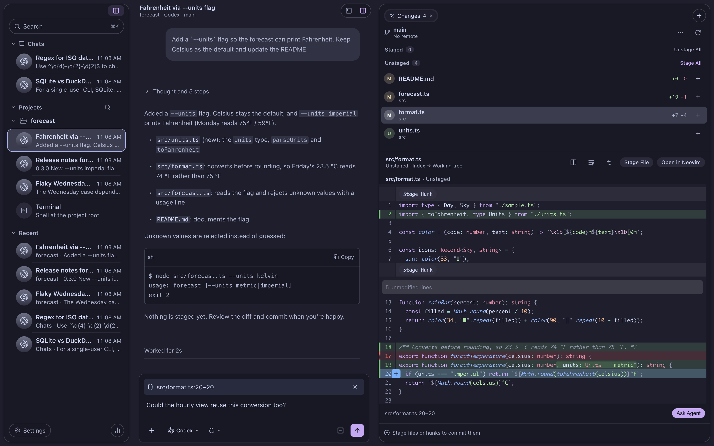
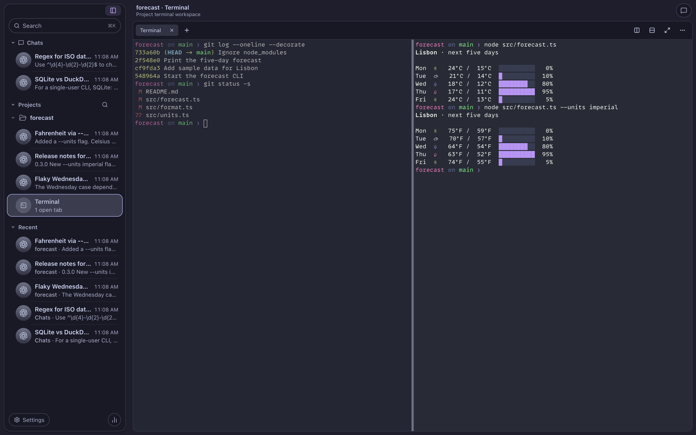
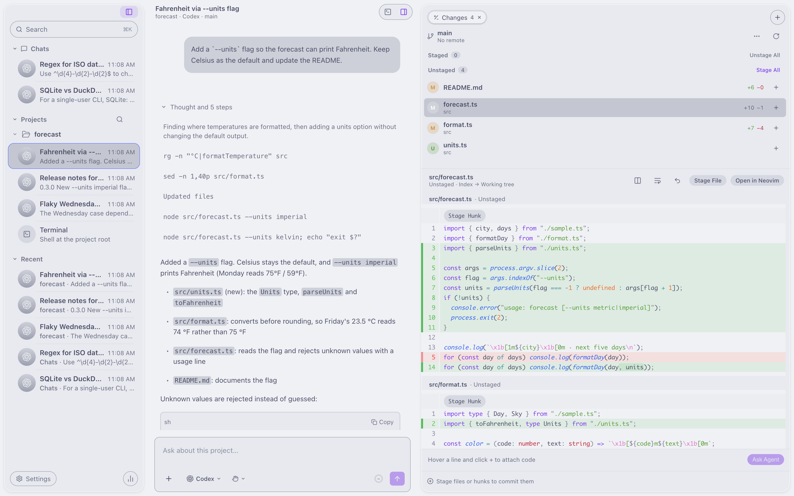

# Octo

A macOS workspace for coding agents: projects and nested chat threads on the left, conversation and code review together, and a persistent terminal workspace for each project.



| | |
| --- | --- |
|  |  |
| Each project gets a tiled terminal whose shells keep running while hidden. | Light and dark themes; the agent's reasoning and commands stay one click away. |

**Status:** in development, not a production release. Octo is built with Electron.

## Run

Requires macOS, Node 24 or newer, and pnpm through Corepack (`corepack enable`).

```sh
gh repo clone NikkoSanchez/octo
cd octo
make setup     # pnpm install, including the Electron runtime
make test      # unit tests (Vitest)
make build     # typecheck and production build
make smoke     # launches the built app with Playwright against a throwaway data folder
```

**Using Octo:** `make install` builds the release app and puts it in `~/Applications/Octo.app`. If it is running, nothing is interrupted: the new version replaces it once you quit.

**Changing the code:** `make run` builds and opens **Octo Dev** (`build/Octo Dev.app`), a separate copy with its own name, bundle ID (`dev.octo.app.dev`) and chats (`~/Library/Application Support/Octo Dev`). `pnpm dev` runs the same development identity with hot reload.

## Use

The sidebar shows Chats, Projects and Recent. Create a chat with **+** or ⌘N, or add a Git repository with the Projects **+** or ⇧⌘O. Threads support pinning, renaming and removal through their context menus. Lists start with five threads; Show more adds ten, and selected or working threads stay listed.

Write in the composer and press Return to send, or Shift–Return for a new line. Markdown lists continue on Shift–Return and indent with Tab / Shift–Tab. IME composition does not send. Draft text stays with its thread for this app session. Use **+** or paste an image to attach screenshots; code and browser captures added by services stay in the draft until an explicit Send. Type `/` for commands advertised by the selected provider; selection inserts a command without sending it.

Choose the provider, model and supported reasoning effort through the agent menu, and permissions beside it. Full access requires confirmation. Provider changes on conversations with history start a new thread. Install and authenticate the CLIs separately; Settings → Agents shows executable discovery and supports choosing a Codex installation. Provider approvals and forms require explicit replies. Unsupported controls and missing metrics remain unavailable.

While the agent works, sending queues a follow-up (up to 20). Codex offers Steer now. Stop or a failed turn pauses delivery; Send queued resumes it. Drafts, queued messages and pending decisions are local to the running session.

The transcript follows new output while you are near its bottom. Scroll up to read, then use Scroll to end to resume following. ⌘K searches chats in the sidebar (or the palette when it's hidden), ⇧⌘K switches projects, ⌘F finds messages in the current thread, and ⇧⌘P opens the command palette. ⌘B toggles the sidebar, ⌥⌘B toggles the project review panel, ⌘1 focuses the composer, and ⌘. stops the current agent. Hold ⌘ to show shortcut hints. Settings (⌘,) has Appearance (themes), Keyboard and Agents. Narrow windows use a sidebar overlay.

Use ⌘2 for Changes, ⌘3 for Files, ⌘P to open a checkout file, and ⌘5 for the browser. Changes supports split or stacked diffs, file and hunk staging, safe discard, explicit commits, and generated commit-message drafts. Hover a code line and use **+**, or select lines, to attach source context to the composer. Files open in retained Pierre editor sessions with undo, debounced atomic saves and ⌘S. The wrap button beside a diff or file soft-wraps long lines in both views. An outside change preserves your draft and blocks saving until you explicitly reload.

⌘J opens the project's terminal workspace. Tabs and split panes retain their shells, scrollback and terminal state while hidden; drawing pauses without stopping output. Open in → Neovim runs your installed `nvim` with its own configuration (LazyVim or anything else) and reuses its running socket. Exiting Neovim returns to a login shell. Settings → Agents can open a dedicated Claude CLI sign-in terminal. See [terminal configuration](docs/TERMINAL.md) for the supported Ghostty settings.

Browser panels retain pages while hidden. Use the address bar, device/appearance controls, screenshots or the element/region picker. Captures attach to the draft as untrusted page context and require an explicit Send. Private tabs use an in-memory session. Pages are denied camera, microphone and other device permissions. Native browser pages yield app shortcuts to Octo; browser views hide while dialogs are open.

The titlebar groups terminal and review controls in a capsule. With review closed, wide project workspaces show the floating Open in / branch / Changes card beside the chat; narrower windows open that card from Project actions in the capsule. Changes is a full-height card aligned with the sidebar, with file groups above the diff and the commit composer below it. More Git actions offers stage/unstage all, stashes, pull, fetch and discard; Create PR uses the GitHub CLI. Account usage limits in the sidebar footer shows provider-reported values when available, and its Usage Dashboard summarizes local CLI token logs. Unknown limits remain unavailable. Closing the macOS window hides it and keeps sessions alive; Quit flushes editor drafts and asks what to do if a conflicting file cannot be saved.

Provider protocols are covered by automated fixtures without paid calls. Live provider authentication, remote push and pull-request operations, assistive technology, multiple displays and long-running daily use still need your own evaluation.

## Layout

| Location | Responsibility |
| --- | --- |
| `apps/desktop/src/main` | Main process: window, identity, app state owner, processes |
| `apps/desktop/src/preload` | The narrow typed bridge exposed to the renderer |
| `apps/desktop/src/renderer` | React UI |
| `apps/desktop/src/shared` | IPC contract and identity shared by main, preload and renderer |
| `packages/core` | Domain model, archive codec, review/capture types, Markdown, themes, search, split layout; `@octo/core/node` adds storage, checkout file access and subprocesses |
| `packages/agents` | Provider adapters (Codex, Claude) |
| `packages/git` | Git status, snapshots and actions |

Start with [architecture](docs/ARCHITECTURE.md). Agent contributors should read [AGENTS.md](AGENTS.md).

## Local data

Each Mac has its own workspace at `~/Library/Application Support/Octo/workspace.json`, in schema-v1 JSON. A folder Octo owns carries an `.octo` marker; if an unmarked `…/Octo` already exists, Octo explains and quits rather than write into it. The folder is owner-only (`0700`), the archive owner-only (`0600`), written atomically, and excluded from Time Machine. Storage inside a Git checkout is refused. A corrupt or newer-version archive is preserved and saving is disabled for that launch. For development, `OCTO_WORKSPACE_PATH` selects an isolated archive and `OCTO_USER_DATA` an isolated data folder.

## License

MIT. Third-party software keeps its own license; see [THIRD_PARTY_NOTICES.md](THIRD_PARTY_NOTICES.md).
